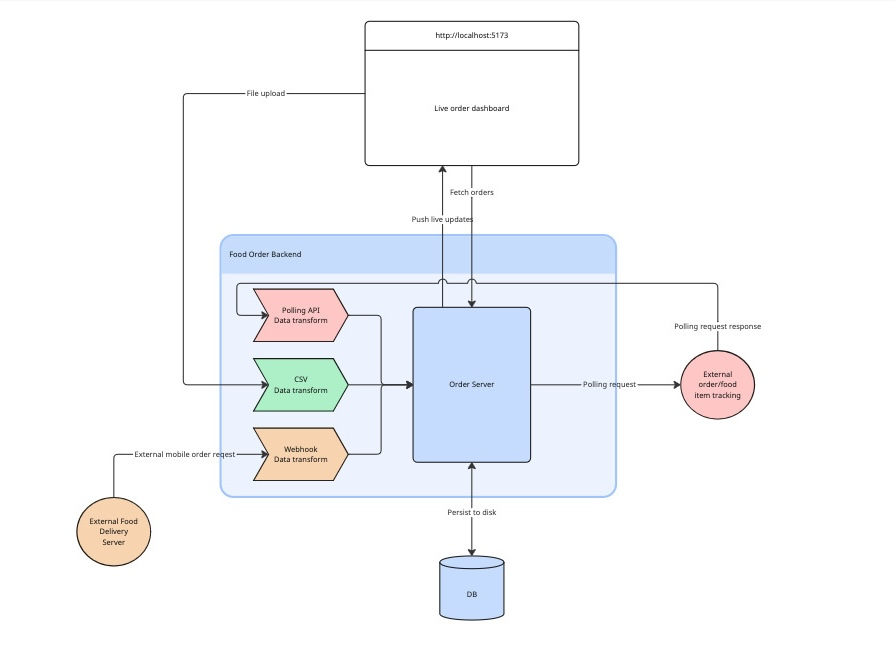

# Architecture & Considerations


*System Diagram*

## Initial Brief

This is a food order system that needed to be designed to support data ingestion from three separate pipelines:

- A webhook-like stream of new orders
- Polling and external server for updates
- CSV upload

There were initial data sets provided from these three sources to be used as a reference (see [references](/references/))

### Requirements

- Minimal working front-end & back-end system
- Support real time and scheduled orders
- Provide views to show orders by status and other relevant metadata
- Provide a view of each order and a history of any changes or events that are tied to that order
- Skeleton a payload for orders to be dispatched to be made
- The system must handle ~100,000 requests per day

## Initial considerations

### Backbone

Given the need to get the minimal prototype up and working within that rough 4-6 hour estimated time window I make some compromises for speed and familiarity over robustness and maintainability.

I went with Python and [FastAPI](https://fastapi.tiangolo.com/) as the server backend. This was for a few reasons. The first was speed of prototyping, as it is easy to add API endpoints (fast *is* in the name) while thanks to the asyncio compatibility, among other things, should be able to easily handle several thousand requests per second, while also having implicit queueing. ++This should ideally be tested.++ While it might be able to hit that 100,000 orders per day, going to 200,000 and higher would be driving into a corner.

While Python is fast for prototyping and scripting, and it can be deployed to the cloud, for long-living infrastructure ideally something not bespoke and more off-the-shelf for real-time high-throughput data pipelines can be explored ([Kafka](https://kafka.apache.org/), [RabbitMQ](https://www.rabbitmq.com/), or even off-the-shelf with dashboards like [ThingsBoard](https://thingsboard.io/), etc.). I also shied away from those because of this needing to be "turn-key", and was avoiding the extra installations steps for those for now. So, while this prototype might work for something simple, it will not have the robustness, industry testing, nor efficiency for a long-standing deployed systems as might be preferred. Especially with questions remaining such as:

- How many dashboards/monitors will be running in parallel?
- How many more data integrations do we foresee?
- Does this system prioritize food order tracking or food item tracking?
- Is this system going to be deployed to the cloud or a local server?
- What kind of security do we need? Likely TLS and logins but does there need to be SSO?
- How do we mitigate downtime and redundancy?

And those are some of the first, but I'll kick those cans for now.

### Food Order and Item Schemas

First thing I noticed is that the three data ingestion structures do not cleanly align.

#### Webhook

```json
{
    "order_id": "c59a0083-581d-4eb9-946e-98b32890be3a",
    "order_source": "Overeats",
    "restaurant": "Sam & Ella's",
    "first_name": "Laura",
    "last_name": "Kinney",
    "total": 144.16,
    "items": [
        "Lemon meringue pie",
        "Cherry pie \u00e0 la mode",
        "Chicken fried steak",
        "Grilled cheese with tomato soup"
    ],
    "notes": ""
}
```

#### Polling API

```json
{
    "7be39c2e042b576a218ea85f126f9ff98f4cea4a5655f03ca402430a0bc4f68f": {
        "order": 4645,
        "name": "Grilled cheese with tomato soup",
        "category": "Lunch & Dinner",
        "price": 12.74,
        "status": "ordered"
    }
    [...]
}
```

#### CSV Form

```text
first_name: Wade
last_name: Wilson
items: "Fried banana, Sweet tea, Apple pie, Classic chicken sandwich, Espresso, Croissant"
notes: ""
tomorrow: true
meal: breakfast
```

The webhook orders have an order UUID string and order source (seemingly from the app), the polling API returns **food item** updates, not **order** updates, and has hashes and integer-based order numbers. But also provides additional information about those food items that is not present in the CSV nor webhook entries (individual item prices, categories, etc.). Scheduling is also only present with the CSV, with a general today/tomorrow and meal.

### Database & Persistence

Since this needs to handle 100,000 orders per day, a simple straight-to-disk hashing will not scale. Trying to keep that loaded in memory or doing lookups, while can be designed from scratch, likely will not be performant. Plus the need to design all of the queries and filters likely desired in the future, it's best to use a proper database.

#### My familiarity with databases

Well. I've never spun up a database from scratch. Usually sitting more on the API and integrations side the actual database; so, what database to use, setting up tables, etc. is not within my prior experience. So. Why not learn? For a job application that is supposed to be completed in an evening **"Why not learn it from scratch?"**.

So, then for simplicity and speed in this I went with a SQLite database and leveraged [SQLModel](https://sqlmodel.tiangolo.com/) which is made by the same team as FastAPI, and has a lot of handy integrations with the FastAPI and SQLAlchemy libraries so they work hand in hand. (For instance, the data table models are based off of pydantic models, so they can leverage the automatic loading/verification and dumping of json and dictionary data). Again, this is very much focused on ease of prototyping within the time frame.

### Dashboard & Client

I went with [Svelte](https://svelte.dev/) on this one. Being a web-framework, it leaves open the option for this to be a cloud-deployed dashboard, with isolated customer sign-ins or on-premise servers, etc. Plus, these days the integrations for taking Figma mock-ups from a product designer or integrating company branding, color schemes, etc. makes it easy. Combining this with SvelteKit can also build out a static webpage to remove package dependency bloat for the final deployment. (I also went with yarn as the package manager out of habit.)

## General Approach

The general architecture is then as follows:

- FastAPI server with SQLModel/SQLlite database.
  - The python codebase is then responsible as also the data transformer from the external sources.
- Svelte client dashboard.
- Python tooling for simulating the external polling API, and webhook orders.
