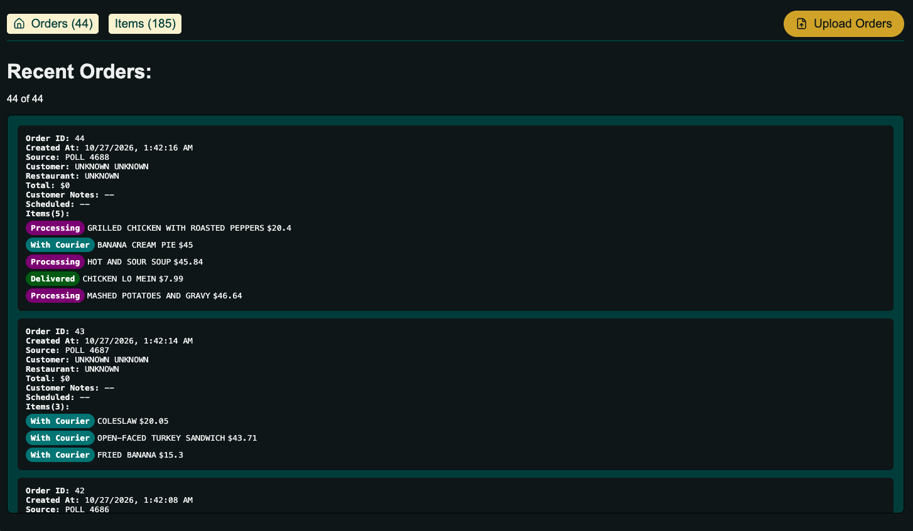
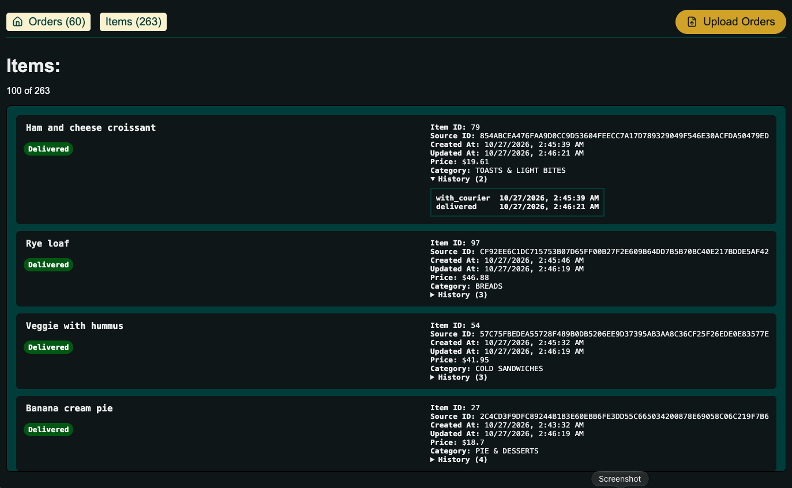
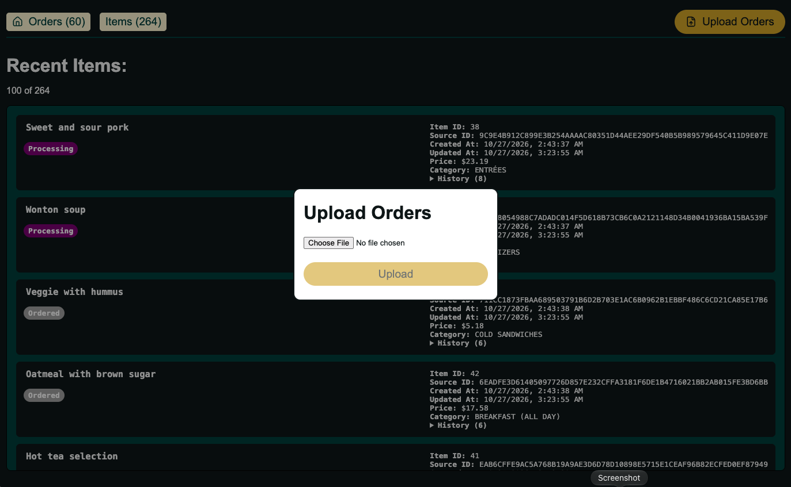

# L37 Food Order Tracking

This is a prototype of a order tracking system that can handle ingestion of order information from several sources (see [sample data and references](references)). No AI was used to develop this (for better or for worse).

## Architecture & Considerations

Notes about architecture and other considerations, outstanding questions, and follow up are found in the dedicated page (see [Architecture Choices](ARCHITECTURE.md))

## Installation

There is a Makefile that can be referred to for available commands. There was a world where I dockerized this and/or bundled and built out the static webpages to make this more "turn-key" but that was forgone for time as well as leaving the door open to make on-the-fly code changes during demonstration and testing.

### Requirements

The following tool packages are what were on the system used to build this:

- UV (v0.13.4) <https://docs.astral.sh/uv/>
- Yarn Classic (v1.22.22) <https://classic.yarnpkg.com/en/docs/>
- GNU Make (v3.81) <https://www.gnu.org/software/make/>

### Installation steps

Should be (hopefully) as simple as running the following command:

```bash
make install
```

Which will install all the necessary python dependencies via UV as well as installing the front-end client package dependencies.

### Running

The running steps are why I'd want to containerize this with Docker or Podman or something similar, however for now to run locally there are two ways. A singular command:

```bash
make run
```

or the backend and front-end separately

`make run-ux` alongside `make run-server`

This will spin up the python backend server (defaults to port `8000`) as well as the local front-end client server (defaults to port `5173`)

You can go to [localhost:5173](http://localhost:5173) to then view the client dashboard

### Tools

There are several tools that are designed to be run in parallel to simulate the different sources of food orders.

- [Webhook Mimic](tools/webhook-mimic/README.md)
- [Polling API Mimic Server](tools/api-poll-mimic/README.md)
- CSV Upload (can be done via front-end client)

## Client

### Recent Orders Page


*Screenshot of Recent Orders Page*

### Recent Items Page


*Screenshot of Recent Items Page*

### CSV Upload


*Screenshot of CSV Upload Modal*
